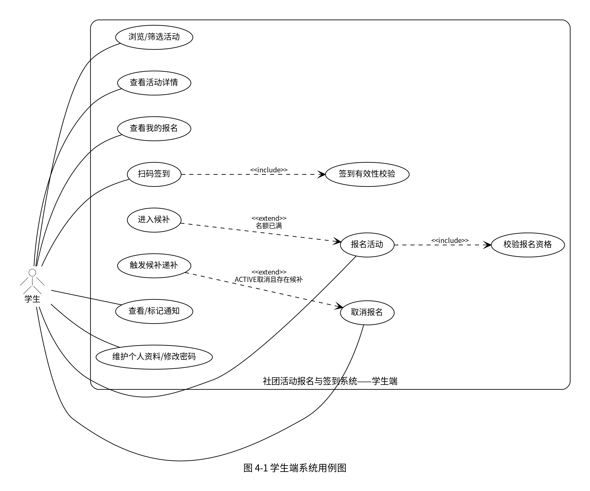
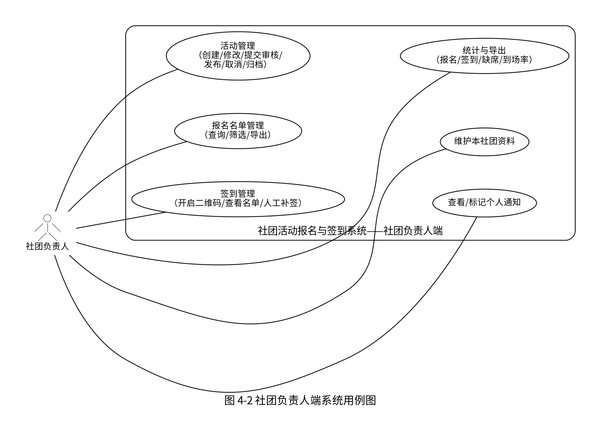
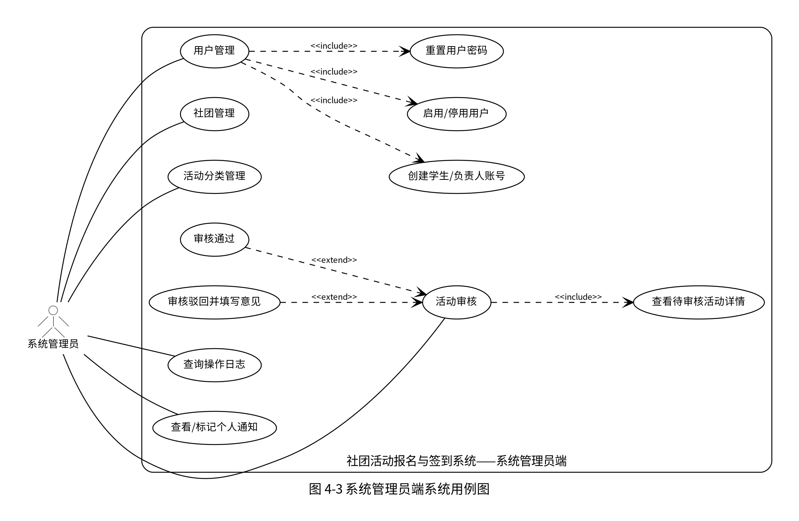

# 08 · 系统需求分析报告（D 部分：G1 / G2 / G14）

> 本文档对应《系统需求分析报告・差距项清单》中 D 成员承担的 G1、G2，以及可选加强项 G14。
> 内容以 `01-项目概述与需求基线`、`04-接口规范与 API 设计`、数据库脚本和当前 Java/Spring Boot 实现为准；当设计文档与当前实现存在差异时，以现有可运行实现所支持的业务行为作为本节用例口径。

---

## 1.1 项目背景与目标（G14）

### 1.1.1 项目背景

高校社团活动具有数量多、参与人员分散、组织流程频繁等特点。传统活动组织通常依赖群聊、在线表格或纸质名单完成通知、报名与签到，容易出现信息入口分散、报名状态难以同步、名额控制不准确、候补递补依赖人工处理以及现场签到统计效率低等问题。活动结束后，负责人还需要手工汇总报名人数、签到人数和缺席情况，不利于形成完整、可追溯的活动管理记录。

针对上述问题，本项目建设“社团活动报名与签到系统”，面向学生、社团负责人和系统管理员提供统一的组织事务协作平台。系统围绕活动全生命周期建立从活动创建、审核、发布、报名、候补、取消、签到到统计归档的业务闭环，并通过角色权限控制、事务化名额管理、限时二维码签到、站内通知和操作日志等机制提升活动组织效率与数据可靠性。

### 1.1.2 项目目标

本系统的建设目标如下：

1. 建立统一的社团活动信息入口，使学生能够按关键词、社团、分类、状态和时间范围查询活动，并查看活动详情与个人报名状态。
2. 建立规范的活动管理流程，使社团负责人能够完成活动创建、修改、提交审核、发布、取消和归档，系统管理员能够完成活动审核与基础数据管理。
3. 建立可靠的报名与候补机制，在并发场景下防止重复报名和超额报名；活动满员后自动进入候补队列，在有效报名取消时按照候补顺序完成递补。
4. 建立高效且可追溯的签到机制，由社团负责人开启限时二维码签到，学生扫码完成签到，并支持负责人对报名成功但未签到的学生进行人工补签。
5. 建立统计、通知与审计能力，提供报名人数、签到人数、缺席人数和到场率统计，支持名单导出，并在审核、报名、候补递补、活动取消和签到开启等关键节点发送站内通知、记录操作日志。

---

## 4.2 系统用例图（G1）

系统主要包含三类参与者：学生、社团负责人和系统管理员。三类角色具有明确的数据与操作边界：学生仅处理本人报名、签到及公开活动信息；社团负责人仅管理本社团活动、名单、签到和统计；系统管理员负责全局用户、社团、活动分类、活动审核和操作日志管理。

### 4.2.1 学生端用例图

学生端围绕“查看活动—报名/候补—取消—签到—个人记录”形成完整参与闭环。报名时系统统一校验活动状态、报名截止时间和重复报名情况；名额已满时进入候补。学生取消有效报名后，如果存在候补人员，系统将触发候补递补。扫码签到时系统校验签到码、活动状态、报名状态与重复签到情况。

**图 4-1 学生端系统用例图**

学生端主要用例包括：浏览和筛选活动、查看活动详情、报名活动、进入候补、取消报名、查看个人报名记录、扫码签到、查看通知以及维护个人资料和密码。其中，“进入候补”是报名活动在名额已满条件下的扩展流程；候补递补是 ACTIVE 报名取消且存在 WAITING 候补时的扩展业务行为；扫码签到包含签到有效性校验。

### 4.2.2 社团负责人端用例图

社团负责人端围绕本社团活动运营展开，核心职责包括活动管理、报名名单管理、签到管理、统计与导出、社团资料维护和个人通知查看。系统对负责人接口执行角色校验和活动归属校验，负责人不可读取或操作其他社团活动的数据。

**图 4-2 社团负责人端系统用例图**

活动管理包括活动创建、修改、提交审核、发布、取消和归档；报名名单管理支持按状态查询并导出名单；签到管理包括开启限时二维码、查看签到/未签到名单以及人工补签；统计与导出提供报名成功人数、签到人数、缺席人数和到场率等指标。

### 4.2.3 系统管理员端用例图

系统管理员负责系统级基础数据和审核管理。管理员可维护用户、社团和活动分类，对负责人提交的待审核活动执行通过或驳回，并查询系统操作日志。活动驳回时必须填写审核意见，审核结果通过站内通知反馈给活动所属社团负责人。

**图 4-3 系统管理员端系统用例图**

管理员用户管理包括创建学生/负责人账号、启用或停用用户以及重置密码；活动审核包括查看待审核活动信息并执行通过或驳回；管理员还能够维护社团、活动分类，查询操作日志并查看个人通知。

---

## 4.3 核心用例描述（G2）

### 4.3.1 UC-01 活动报名（含候补）

| 项目 | 内容 |
| --- | --- |
| 用例编号 | UC-01 |
| 用例名称 | 活动报名（含候补） |
| 主要参与者 | 学生 |
| 触发条件 | 学生在活动详情页点击“立即报名” |
| 前置条件 | 1. 学生已登录且角色为 STUDENT；2. 活动存在；3. 活动状态为 `PUBLISHED`；4. 当前服务器时间未超过报名截止时间；5. 学生在该活动下不存在 `ACTIVE` 或 `WAITING` 状态的有效报名记录 |
| 后置条件 | 报名成功时生成/更新 `ACTIVE` 报名记录并占用 1 个活动名额；满员时生成/更新 `WAITING` 报名记录并分配候补序号，不占用活动名额；系统发送对应站内通知并记录操作日志 |

**主流程：**

1. 学生进入活动详情页，查看活动时间、地点、容量、剩余名额及本人报名状态。
2. 学生点击“立即报名”，客户端向系统提交活动报名请求。
3. 系统在事务中锁定活动记录，检查活动是否存在。
4. 系统校验活动状态必须为 `PUBLISHED`，并以服务器时间判断是否已超过报名截止时间。
5. 系统锁定并查询该学生在本活动下的已有报名记录；如果已经是 `ACTIVE` 或 `WAITING`，则拒绝重复报名。
6. 系统执行条件更新尝试占用名额：仅当活动仍为 `PUBLISHED` 且 `enrolled_count < capacity` 时将 `enrolled_count` 加 1。
7. 条件更新成功，系统将报名记录保存为 `ACTIVE`，记录报名时间并清除旧取消时间。
8. 系统向学生发送“报名成功”站内通知，并写入报名操作日志。
9. 系统向客户端返回报名结果 `ACTIVE`，页面刷新并显示报名成功状态。

**备选/异常流程：**

- **A1 名额已满：**第 6 步条件更新未成功时，系统进入候补分支，计算当前候补最大序号并加 1，将报名记录保存为 `WAITING`，返回候补序号；系统发送“已进入候补”通知并记录日志。
- **A2 重复报名：**学生已存在 `ACTIVE` 或 `WAITING` 记录时，系统返回重复操作错误，不新增记录、不修改名额。
- **A3 活动状态不允许：**活动不是 `PUBLISHED` 时，系统拒绝报名。
- **A4 报名已截止：**服务器当前时间超过 `signup_deadline` 时，系统拒绝报名。
- **A5 活动不存在：**活动 ID 无效或记录不存在时，系统返回资源不存在。
- **A6 并发重复请求：**数据库 `UNIQUE(activity_id, user_id)` 唯一约束作为并发兜底，避免同一学生产生重复报名记录。

**业务规则：**

1. `ACTIVE` 表示报名成功并占用名额，`WAITING` 表示候补且不占用名额。
2. 同一活动、同一学生只保留一条报名记录；曾经取消的记录可在满足报名条件时重新激活或重新进入候补。
3. 名额占用采用“事务 + 活动行锁 + 条件更新 + 唯一约束”控制，保证并发场景下不超卖。

---

### 4.3.2 UC-02 活动审核

| 项目 | 内容 |
| --- | --- |
| 用例编号 | UC-02 |
| 用例名称 | 活动审核 |
| 主要参与者 | 系统管理员 |
| 次要参与者 | 社团负责人 |
| 触发条件 | 社团负责人将草稿或被驳回活动提交审核，管理员在审核页面处理 `PENDING` 活动 |
| 前置条件 | 1. 负责人已登录且活动归属本社团；2. 活动当前状态为 `DRAFT` 或 `REJECTED`；3. 活动时间、报名截止时间、容量等字段通过校验；4. 管理员已登录且角色为 ADMIN |
| 后置条件 | 审核通过后活动状态变为 `APPROVED`，负责人可继续发布；审核驳回后活动状态变为 `REJECTED` 并保存审核意见，负责人可修改后重新提交；系统发送审核结果通知并记录管理员操作日志 |

**主流程（审核通过）：**

1. 社团负责人在本社团活动管理页面选择草稿或被驳回的活动并执行“提交审核”。
2. 系统校验活动归属、当前状态及时间字段，校验通过后将活动状态更新为 `PENDING`，清空旧审核意见并记录提交审核日志。
3. 系统管理员进入活动审核页面，系统默认查询待审核活动列表。
4. 管理员查看活动标题、所属社团、分类、地点、活动时间、报名截止时间、容量、活动简介等信息。
5. 管理员确认活动内容符合要求，选择“审核通过”。
6. 系统再次校验活动当前状态必须为 `PENDING`。
7. 系统将活动状态更新为 `APPROVED`，清空审核意见并更新修改时间。
8. 系统向该活动所属社团负责人发送“审核通过”站内通知，并写入管理员审核操作日志。
9. 负责人收到审核结果后，可在活动管理页面执行发布操作，将 `APPROVED` 活动变为 `PUBLISHED`。

**备选/异常流程：**

- **B1 审核驳回：**管理员选择“驳回”并填写非空审核意见；系统校验活动仍为 `PENDING` 后，将状态改为 `REJECTED`，保存审核意见，通知负责人并记录日志。负责人之后可修改活动并再次提交审核。
- **B2 非待审核状态：**如果活动已被其他操作处理、不再处于 `PENDING`，系统拒绝重复审核。
- **B3 活动不存在：**系统返回资源不存在。
- **B4 负责人越权：**负责人尝试提交其他社团的活动时，系统拒绝操作。
- **B5 提交状态不允许：**只有 `DRAFT` 或 `REJECTED` 活动可以提交审核；`PENDING`、`APPROVED`、`PUBLISHED` 等状态不可重复提交。
- **B6 活动字段非法：**结束时间不晚于开始时间、报名截止时间晚于开始时间、容量小于 1 或分类不存在时，系统拒绝提交。

**业务规则：**

1. 当前实现的核心状态流转为 `DRAFT/REJECTED → PENDING → APPROVED 或 REJECTED`。
2. `PENDING` 状态下负责人不可直接修改活动；驳回后方可修改并重新提交。
3. `APPROVED` 仅表示审核通过，活动仍需负责人执行发布后才对学生形成正常报名入口。
4. 驳回操作必须携带审核意见；审核结果发送给活动所属社团负责人。

---

### 4.3.3 UC-03 扫码签到

| 项目 | 内容 |
| --- | --- |
| 用例编号 | UC-03 |
| 用例名称 | 扫码签到 |
| 主要参与者 | 学生 |
| 次要参与者 | 社团负责人 |
| 触发条件 | 负责人开启活动签到并展示二维码，学生使用移动设备扫描二维码 |
| 前置条件 | 1. 负责人有该活动管理权限；2. 活动状态为 `PUBLISHED` 或 `ENDED`；3. 系统已生成有效签到码；4. 学生已登录且角色为 STUDENT；5. 学生在该活动中的报名状态为 `ACTIVE`；6. 学生尚未完成该活动签到 |
| 后置条件 | 成功时新增一条 `attendance` 记录，`sign_type=QR`，记录学生与签到时间；系统写入扫码签到日志；同一活动同一学生不能重复签到 |

**主流程：**

1. 社团负责人进入活动签到管理页面并点击“开启签到”。
2. 系统校验活动存在、活动归属当前负责人，且活动状态为 `PUBLISHED` 或 `ENDED`。
3. 系统将该活动此前仍有效的签到码作废，生成新的随机 Token，设置有效期为当前时间后 5 分钟，并返回二维码地址。
4. 系统向该活动所有 `ACTIVE` 报名学生发送签到提醒通知。
5. 负责人展示二维码，学生使用移动设备扫描。
6. 浏览器访问公开扫码落地地址；系统检查 Token 是否存在、是否有效且未过期。校验通过后，302 跳转到对应活动详情页并携带 `signinToken`。
7. 学生活动详情页检测到签到 Token，提示学生确认签到；学生确认后提交签到请求 `{activityId, token}`。
8. 系统依次校验：签到码存在且有效、未过期、签到码所属活动与请求活动一致。
9. 系统校验活动状态仍允许签到，即 `PUBLISHED` 或 `ENDED`。
10. 系统校验学生在该活动中的报名状态为 `ACTIVE`。
11. 系统插入签到记录，数据库唯一约束保证同一活动同一学生只能存在一条签到记录。
12. 系统记录“扫码签到”操作日志，并向客户端返回签到成功结果。

**备选/异常流程：**

- **C1 签到码无效或已作废：**系统拒绝签到并记录异常日志。
- **C2 签到码过期：**超过 5 分钟后扫码，系统提示签到码无效或已过期，并记录异常日志。
- **C3 签到码与活动不匹配：**Token 对应活动与提交的 `activityId` 不一致时，系统拒绝签到并记录异常日志。
- **C4 活动状态不允许：**活动不是 `PUBLISHED` 或 `ENDED` 时，系统拒绝签到。
- **C5 未报名成功：**学生没有报名记录，或报名状态为 `WAITING` / `CANCELLED` 时，系统拒绝签到。
- **C6 重复签到：**数据库唯一约束检测到同活动重复签到时，系统返回重复操作错误并记录异常日志。
- **C7 二维码落地时已过期：**公开落地页直接显示“签到码无效或已过期”，不跳转签到页。

**业务规则：**

1. 每次重新开启签到都会作废该活动旧签到码；当前有效签到码有效期固定为 5 分钟。
2. 候补学生 `WAITING` 不具备签到资格，只有 `ACTIVE` 报名可以签到。
3. 同一活动对同一学生执行活动级防重复签到，不区分扫码次数。
4. 如学生无法扫码，负责人可通过“人工补签”对 `ACTIVE` 且未签到成员补签，人工补签记录 `sign_type=MANUAL` 及操作负责人。

---

### 4.3.4 UC-04 候补递补

| 项目 | 内容 |
| --- | --- |
| 用例编号 | UC-04 |
| 用例名称 | 候补递补 |
| 主要参与者 | 系统（自动执行业务规则） |
| 关联参与者 | 取消报名的学生、候补学生 |
| 触发条件 | 报名截止前，一名 `ACTIVE` 学生取消报名 |
| 前置条件 | 1. 活动存在；2. 当前服务器时间未超过报名截止时间；3. 取消者存在有效报名记录；4. 取消者状态为 `ACTIVE` 时才可能释放/转移活动名额 |
| 后置条件 | 原报名记录变为 `CANCELLED`；若存在候补，则队首 `WAITING` 记录变为 `ACTIVE` 且活动 `enrolled_count` 保持不变；若不存在候补，则 `enrolled_count` 减 1；递补成功时通知候补学生并记录日志 |

**主流程（存在候补）：**

1. 已报名成功学生在报名截止前点击“取消报名”。
2. 系统在事务中锁定活动记录，校验活动存在并检查当前时间是否仍允许取消。
3. 系统锁定并读取该学生在活动下的报名记录，确认当前存在有效报名。
4. 系统判断取消者状态为 `ACTIVE`，查询该活动 `WAITING` 候补队列中 `queue_order` 最小的第一条记录。
5. 系统发现存在候补，因此不减少活动 `enrolled_count`，将原学生报名状态改为 `CANCELLED`，候补序号清零并记录取消时间。
6. 系统将队首候补记录从 `WAITING` 更新为 `ACTIVE`，候补序号清零。
7. 系统向递补学生发送“候补递补成功”通知。
8. 系统分别记录取消报名和候补递补日志，事务提交。
9. 递补后的活动报名成功人数保持不变，新获得名额的学生后续可正常参加扫码签到。

**备选/异常流程：**

- **D1 无候补：**取消者为 `ACTIVE`，但不存在 `WAITING` 候补时，系统将 `enrolled_count` 减 1，再将原报名记录更新为 `CANCELLED`。
- **D2 候补学生主动取消：**取消者本身为 `WAITING` 时，只将其报名记录更新为 `CANCELLED`，不修改 `enrolled_count`，也不触发其他候补递补。
- **D3 已过报名截止：**系统拒绝取消，因此不会触发递补。
- **D4 无有效报名：**没有报名记录或报名已为 `CANCELLED` 时，系统拒绝重复取消。
- **D5 活动不存在：**系统返回资源不存在。

**业务规则：**

1. 候补递补遵循 `queue_order ASC` 的先到先得顺序。
2. 有候补时，取消者释放的名额直接“转移”给递补者，因此 `enrolled_count` 不减；只有没有候补时才真正释放名额。
3. 取消和递补在同一事务内执行，并先锁定活动行，从而串行化同一活动的名额变化，避免并发重复递补和超卖。
4. 递补成功后候补学生状态变为 `ACTIVE`，具备正常签到资格。

---

## 附录 A：D 部分需求—实现追踪表

| 报告内容 | 主要实现依据 |
| --- | --- |
| 学生端活动浏览、详情、报名、取消 | `ActivityController`、`ActivityService`、`SignupService` |
| `ACTIVE / WAITING / CANCELLED` 报名状态 | `Constants`、`Signup`、`db/schema.sql` |
| 并发名额控制 | `SignupService.signup()`、`ActivityMapper.increaseEnrolled()`、`uk_signup` 唯一约束 |
| 候补递补与名额转移 | `SignupService.cancel()`、`SignupMapper.selectFirstWaiting()` |
| 活动创建、提交审核、发布、取消、归档 | `ManagerActivityController`、`ManagerActivityService` |
| 管理员审核通过/驳回 | `AdminAuditController`、`AdminAuditService`、`Audits.jsx` |
| 二维码开启、扫码签到、人工补签 | `SigninController`、`SigninLandingController`、`SigninService`、`Signin.jsx` |
| 5 分钟签到码与旧码作废 | `SigninService.CODE_VALID_MINUTES`、`signin_code` 表 |
| 报名/签到/缺席/到场率统计及导出 | `StatisticsService`、`ExportService`、负责人端统计页面 |
| 三类角色权限边界 | `Constants`、`RequireRole`、前端 `RequireAuth` 路由守卫 |

